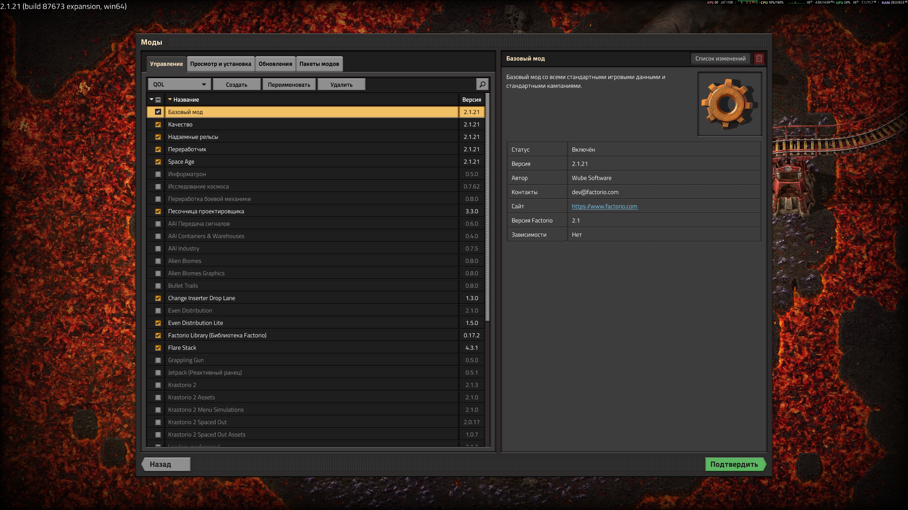
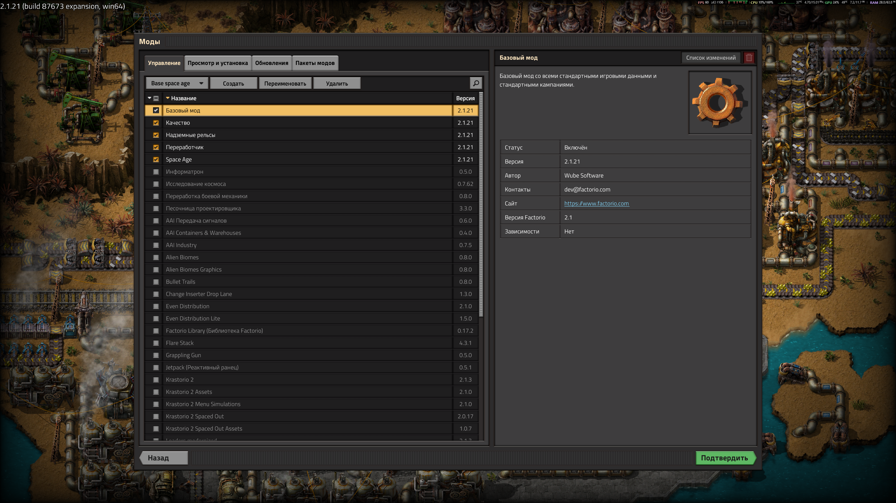
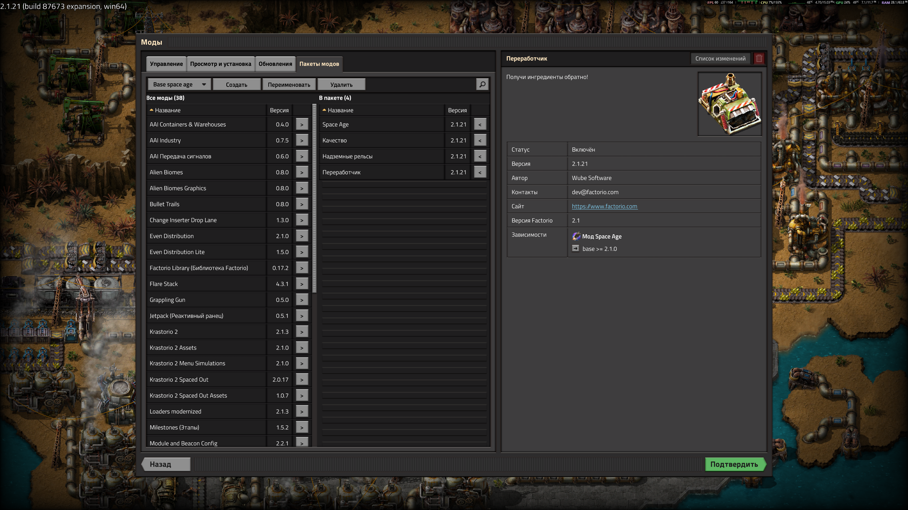
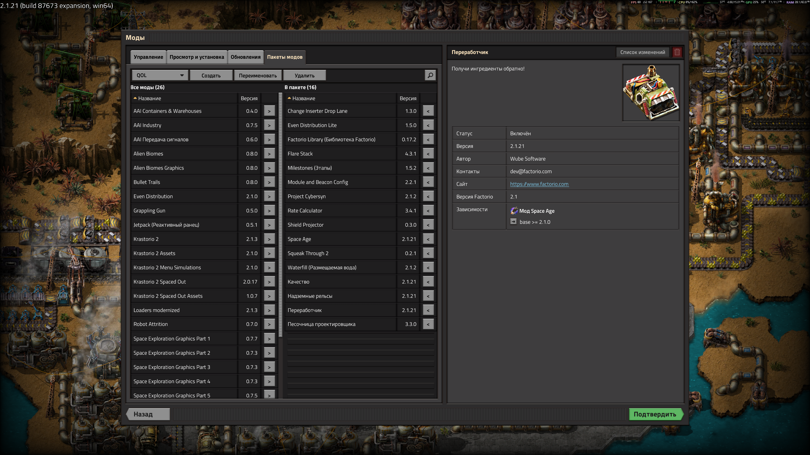

# Пакеты модов для Factorio

**Русский** | [English](README.md)

Нативная модификация клиента Factorio для Windows. Она добавляет в окно **«Моды»** пакеты модов: именованные наборы включённых модов, между которыми можно переключаться в пару кликов.

Это **не обычный мод** из mod portal. Lua-моды Factorio в главном меню не выполняются и не могут менять окно модов. Поэтому модификация — это DLL, которую игра загружает при старте. Сам `factorio.exe` не изменяется.

Проверено на Factorio 2.1.21 (Steam, Windows 11).



## Что она делает

### Вкладка «Управление»

Слева от поля поиска появляется панель пакетов: выпадающий список и кнопки «Создать», «Переименовать», «Удалить».



- **Выпадающий список** показывает выбранный пакет. Пока пакетов нет, в нём написано «Нет пакетов». При выборе пакета галочки модов расставляются по нему: моды пакета включаются, остальные выключаются, `base` не трогается. Применяются изменения **штатной кнопкой «Подтвердить»**, и игра перезапускается как обычно. Если закрыть окно без подтверждения, игра предложит отменить изменения, и ничего не поменяется.
- **Галочки при выбранном пакете** меняют этот пакет. Правки копятся как черновик и записываются в пакет по **«Подтвердить»** (или по согласию применить изменения при выходе из окна), при выборе другого пакета в списке и при переходе на другую вкладку. До этого справа от списка видна пометка `*`. В пакете меняются только моды, которые вы включили или выключили; не установленные моды пакета остаются в нём. Если выйти из окна, отменив изменения, пакет тоже не изменится.
- **При открытии окна** в списке выбран пакет, совпадающий с включёнными сейчас модами, или «Пакет не выбран», если такого нет. Открытие окна не меняет ни галочки, ни пакеты.
- **Создать** сохраняет все моды, отмеченные сейчас галочками, в новый пакет. Название вводится прямо в панели, затем «OK» или «Отмена».
- **Переименовать** меняет название выбранного пакета. Поле заполнено текущим названием.
- **Удалить** удаляет выбранный пакет после вопроса «Удалить пакет «…»?» с «Да» и «Нет». Галочки модов при этом не меняются.

Пустые названия и повторы (без учёта регистра, `Test` и `test` считаются одним названием) не принимаются, ошибка показывается красным текстом в панели. Если в пакете есть мод, который не установлен, остальные моды включатся, а модификация покажет список отсутствующих.

### Вкладка «Пакеты модов»

Новая вкладка правее «Обновлений». Здесь удобно собирать состав пакета.



- Две таблицы в том же стиле, что на «Управлении», каждая на половину ширины. Слева все установленные моды, кроме `base` и тех, что уже в пакете. Справа моды выбранного пакета. Над таблицами указано число модов.
- В строке: название, версия и маленькая квадратная кнопка; строки той же высоты, что на «Управлении». `>` добавляет мод в пакет, `<` убирает его. Изменения сохраняются сразу.
- Стрелка в заголовке «Название» сортирует таблицу по алфавиту в одну или другую сторону, у каждой таблицы своё направление.
- Поиск (лупа) фильтрует **обе** таблицы одновременно.
- Щелчок по моду подсвечивает его строку и показывает справа ту же информацию о нём, что и на «Управлении».
- Моды пакета, которые не установлены, выделены красным и помечены «не установлен».
- Выбранный пакет общий с вкладкой «Управление». Но здесь выбор пакета **не** меняет галочки: пакет только открывается для редактирования.



### Язык

Тексты модификации на русском, если игра на русском, и на английском во всех остальных случаях. Это касается и установочных скриптов.

## Установка и удаление

Нужно: Windows 10/11 x64 и Factorio для Windows, в папке которой есть `bin\x64\factorio.pdb`. В Steam-версии этот файл есть.

### Установка из релиза

1. Откройте страницу [релизов](https://github.com/MonSSteRFF/factorio_mod_manager/releases) и скачайте `.zip`-архив из раздела **Assets** последнего релиза.
2. Распакуйте архив в любую папку, например на рабочий стол (правой кнопкой по архиву → «Извлечь все…»). Распаковывать в папку игры не нужно, скрипт сам скопирует файлы куда надо.
3. Закройте Factorio.
4. В распакованной папке запустите `install.bat` двойным щелчком. Запускайте его именно из распакованной папки, а не изнутри архива: без соседней папки `files` скрипт не найдёт DLL.
5. Запустите игру и откройте окно «Моды».

Чтобы обновить модификацию, скачайте архив нового релиза и так же запустите его `install.bat`. Чтобы удалить, запустите `uninstall.bat` (подробнее ниже).

Архив устроен так же, как папка `dist/`, которая получается при [сборке из исходников](#сборка-из-исходников):

```
dist/
  install.bat
  uninstall.bat
  files/winmm.dll
  files/modpacks.dll
  files/VERSION
```

### Установка: `install.bat`

Запустите двойным щелчком. Если игра установлена не в Steam или скрипт её не нашёл, передайте путь к игре аргументом:

```bat
install.bat "D:\Games\Factorio"
```

Что делает скрипт:
1. Находит игру: по аргументу, а без него в библиотеках Steam (`libraryfolders.vdf`).
2. Проверяет, что есть `bin\x64\factorio.exe` и `bin\x64\factorio.pdb`.
3. Если Factorio запущена, просит **закрыть клиент игры** и ждёт нажатия клавиши. Просьба повторяется, пока игра открыта. Чтобы отменить установку, закройте окно скрипта.
4. Если в `bin\x64` уже лежит **чужой** `winmm.dll`, останавливается и ничего не перезаписывает.
5. Копирует `winmm.dll` и `modpacks.dll` в `bin\x64` и записывает рядом файл-метку `modpacks.install` со списком своих файлов и версией.

Повторный запуск `install.bat` обновляет модификацию до версии из папки со скриптом. Права администратора не нужны, если папка игры доступна вам на запись.

### Удаление: `uninstall.bat`

1. Находит игру так же, как установщик.
2. Если игра запущена, просит закрыть её.
3. Удаляет **только** файлы, перечисленные в `modpacks.install`, и саму метку. Чужие файлы, например другие DLL в `bin\x64`, не трогает.

После удаления игра в исходном состоянии. Ваши пакеты (`mod-packs.json`) остаются: если поставить модификацию снова, они вернутся.

### Где лежат данные

| Что | Где |
|---|---|
| Пакеты | `%APPDATA%\Factorio\mods\mod-packs.json` (формат — в [docs/mod-packs-format.md](docs/mod-packs-format.md)) |
| Лог модификации | `%APPDATA%\Factorio\modpacks\modpacks.log` |
| Кэш символов | `%APPDATA%\Factorio\modpacks\symcache.json` |

Лог и кэш можно удалить в любой момент, это ни на что не повлияет.

## Как это работает

```
 Steam запускает factorio.exe
      |
      v
 Windows загружает winmm.dll из папки игры (наш прокси)
      |  все вызовы winmm пробрасываются в системную winmm.dll
      |  и загружается modpacks.dll
      v
 modpacks.dll в фоновом потоке (игра стартует без задержки):
      1. находит по factorio.pdb функции и поля окна «Моды»
         (первый раз ~3 с, дальше из кэша до следующего обновления игры)
      2. если всё найдено, ставит хуки на создание окна «Моды»
         если чего-то нет, НЕ ставит ничего, игра работает как обычно
      v
 окно «Моды» строится штатно, а модификация добавляет в него
 панель пакетов и вкладку «Пакеты модов» виджетами самого движка
```

**Обновления игры.** Адреса не зашиты в код, а берутся из `factorio.pdb` той версии, что установлена. Поэтому обычные обновления модификация переживает без пересборки. Если Wube переделает окно модов и нужных функций не окажется, модификация просто отключится, а причина будет в логе. Подробности о движке и чек-лист проверки после обновления — в [docs/engine-notes.md](docs/engine-notes.md).

**Ограничения.**
- Только Windows x64 и сборки с `factorio.pdb`.
- Работает только в окне «Моды» главного меню.
- Настройки модов и версии модов в пакет не сохраняются.
- Это неофициальная модификация закрытого клиента, Wube её не поддерживает. Антивирус может насторожиться на прокси-DLL, исходники открыты.

## Сборка из исходников

Что нужно:
- **Visual Studio 2022** (Community подходит) с нагрузкой «Разработка классических приложений на C++»: MSVC x64 и Windows SDK.
- **CMake 3.20+** на Windows: компонент «C++ CMake tools for Windows» в Visual Studio Installer или `winget install Kitware.CMake`.
- Для служебных скриптов (обычно не нужно): WSL с `python3`, `llvm-readobj` и `llvm-pdbutil`.

Сторонние библиотеки уже лежат в `third_party/` (см. [third_party/README.md](third_party/README.md)): MinHook, nlohmann/json, doctest.

### Из Windows

```bat
build.cmd
```

### Из WSL

```bash
./build.sh
```

Оба скрипта собирают Release x64, запускают юнит-тесты и раскладывают результат в `dist/` вместе с `install.bat` и `uninstall.bat`.

### Проверка совместимости с версией игры

Перед запуском новой версии Factorio можно проверить, найдёт ли модификация всё, что ей нужно:

```bat
build\Release\modpacks_symtool.exe "C:\...\Factorio\bin\x64\factorio.exe"
```

или из WSL: `scripts/check-symbols.sh "/mnt/c/.../Factorio/bin/x64"`.

### Структура исходников

```
src/proxy/   прокси winmm.dll (заглушки экспортов генерирует scripts/gen-winmm-proxy.py)
src/core/    загрузка, разрешение символов по PDB, кэш, хуки, лог, обёртки над движком
src/packs/   логика и хранение пакетов (без зависимостей от движка)
src/i18n/    строки RU/EN и выбор языка
src/ui/      панель пакетов, вкладка «Пакеты модов»
scripts/     install.bat, uninstall.bat, служебные скрипты (см. scripts/README.md)
tests/       юнит-тесты (doctest) и modpacks_symtool
docs/        заметки о движке, формат mod-packs.json, скриншоты
openspec/    спецификации и план изменения (OpenSpec)
```

### Перегенерация прокси

Нужна, только если меняется набор экспортов системной `winmm.dll`:

```bash
python3 -I scripts/gen-winmm-proxy.py /mnt/c/Windows/System32/winmm.dll src/proxy
```
